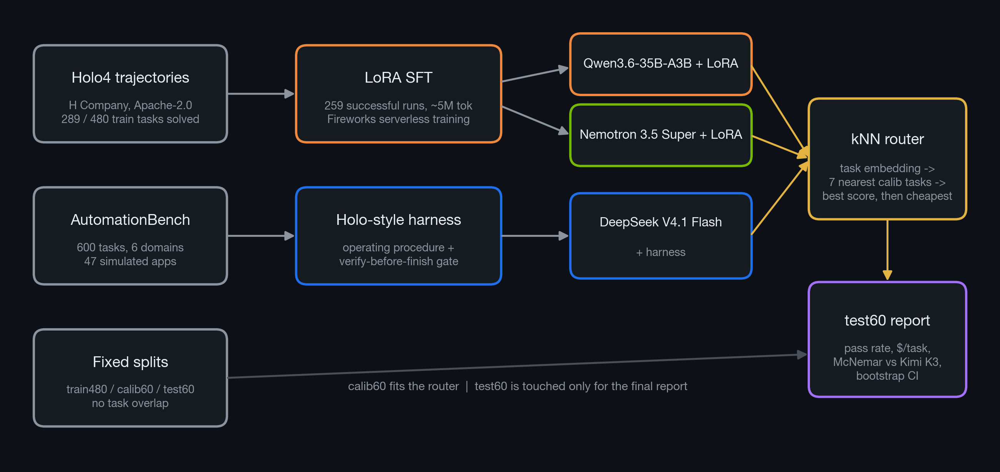
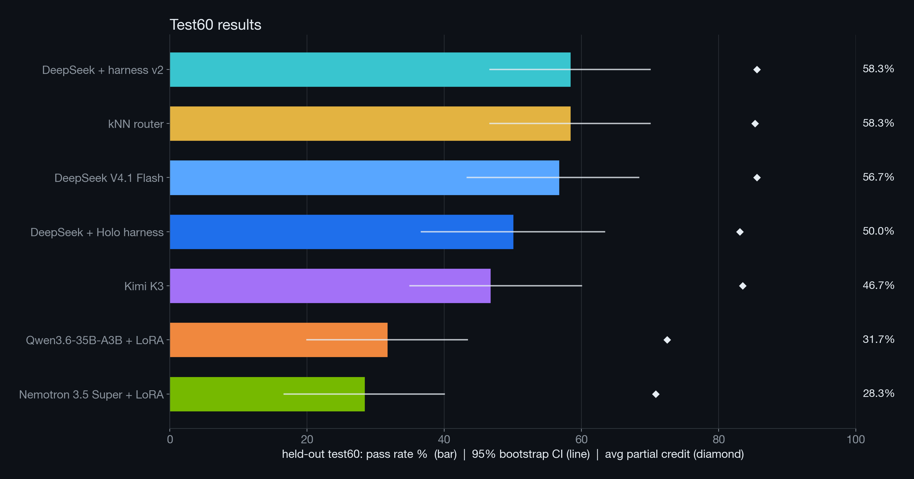

# Holo4-style agents on Zapier AutomationBench

Built for the **Fireworks: Deploy (Microsoft × NVIDIA)** buildathon.

[AutomationBench](https://github.com/zapier/AutomationBench) gives an agent a business request (sales, marketing, ops,
support, finance, HR). The agent must carry it out across simulated apps (Gmail, Slack, Sheets, Salesforce, …) using only
API tools. Grading looks only at the final app state. Frontier models pass about 45–50% of tasks at $0.40–$3 per task.
H Company's [Holo4](https://hcompany.ai/newsroom/holo4) showed that a small, well-trained open model can come close for
about $0.05 per task.

**Goal:** get frontier-level pass rates on Fireworks for a fraction of the cost. We combine three pieces:

1. **A Holo-style harness.** It adds an operating procedure to the system prompt and a check-before-finishing step. Both
   run on cheap open models.
2. **LoRA SFT on Holo4 trajectories.** We fine-tune Qwen 3.6 35B-A3B and Nemotron 3.5 Super VL 120B on H Company's
   successful AutomationBench runs ([`Hcompany/trajectories`](https://huggingface.co/datasets/Hcompany/trajectories)),
   using **train tasks only**.
3. **A learned per-task router.** A kNN over task embeddings picks the cheapest system that is likely to succeed.

New to the benchmark? Open [`explainers/automationbench.html`](explainers/automationbench.html) in a browser.

## Repository layout

| Path | What it is |
|---|---|
| `harness/harness_env.py` | `HarnessEnv`: the stock `AutomationBenchEnv` with the same tools, 50-step budget, and grader, plus the operating procedure and a "verify before finish" nudge (`HARNESS_MAX_NUDGES`, `HARNESS_PROCEDURE`). |
| `harness/run.py` | Drop-in replacement for `auto-bench` that runs the harness env. Takes the same CLI flags. |
| `ft/build_sft_data.py` | Converts Holo4 trajectories (success only, train480 only) into chat and tool-call SFT conversations. |
| `ft/train_lora.py` | LoRA SFT on Fireworks Serverless Training (rank 32, lr 2e-4, 1 epoch, about 5M tokens per model). |
| `ft/proxy.py`, `ft/serve.sh`, `ft/PROXY.md` | OpenAI-compatible `/v1/chat/completions` proxy over the serverless sampler, so AutomationBench can evaluate LoRA checkpoints. |
| `ft/STATUS.md`, `ft/checkpoints.json`, `ft/logs/` | Training status, loss curves, checkpoint paths, and proxy logs. |
| `slides/` | Slide deck (`index.html`, `deck.pdf`), charts (`img/`), and `make_figures.py`, which regenerates both from `runs/`. |
| `analysis/router.py`, `analysis/systems.json` | Per-task router (kNN and per-domain), cost accounting, paired McNemar tests, and bootstrap CIs. |
| `runs/splits.json` | Fixed task splits: `train480` / `calib60` / `test60` (plus `dev30` for screening). |
| `runs/` | Eval outputs (`*.json`, incremental `*.jsonl`, `*.log`), task embeddings, router choices, and `results.md`. |
| `screen.sh` | Screens cheap Fireworks models on dev30. |
| `run_evals.sh` | Evaluates DeepSeek (base and harness) on calib60 and test60. Can resume from `*.jsonl`. |
| `run_ft_eval.sh` | Evaluates a proxy-served LoRA model on calib60 and test60. |
| `patches/` | Our local change to AutomationBench, plus the upstream commit it applies to. |
| `WINNING_PLAYBOOK.md` | Event strategy, Fireworks cheat sheet, and evaluation protocol. |

## Setup

```bash
git clone https://github.com/zapier/AutomationBench
git -C AutomationBench checkout "$(cat patches/AUTOMATIONBENCH_COMMIT)"
git -C AutomationBench apply ../patches/automationbench-eval.patch   # AB_INCREMENTAL_JSONL streaming results
(cd AutomationBench && uv sync)

echo 'FIREWORKS_API_KEY=fw_...' > .env      # gitignored
```

The patch adds one feature: if `AB_INCREMENTAL_JSONL` is set, each finished task is appended to that file as one JSON
line. That lets long runs resume and gives you partial results while they're still going.

For fine-tuning, also clone [`fw-ai/cookbook`](https://github.com/fw-ai/cookbook) into `ft/cookbook/`. Then rebuild the
SFT data with `ft/build_sft_data.py`. The data goes to `ft/data/` and the raw trajectories to `data/traj/`; both are
gitignored because they are large and can be rebuilt.

## Running

```bash
./screen.sh                                   # screen candidate models on dev30
./run_evals.sh                                # DeepSeek base vs harness on calib60 / test60

# Harness on any task list (same flags as auto-bench)
cd AutomationBench && set -a; . ../.env; set +a
uv run python ../harness/run.py --model accounts/fireworks/models/deepseek-v4p1-flash \
  --base-url https://api.fireworks.ai/inference/v1 --api-key-var FIREWORKS_API_KEY \
  --tasks finance.invoice_email_extract --export-json ../runs/example.json

# Fine-tuned models: serve a checkpoint, then evaluate it
ft/serve.sh qwen qwen 8311
./run_ft_eval.sh qwen_ft qwen 8311 0.00000045 0.000001335

# Router and statistics
python3 analysis/router.py analysis/systems.json
```

## Evaluation protocol

- **No leakage.** SFT uses only `train480` trajectories (the build step asserts this). The router is fit on `calib60`
  and reported on `test60`.
- **Metric.** We report pass rate, AutomationBench's official metric: all counted assertions must pass. We also report
  average partial credit and real $/task, priced from token usage including cached-input pricing.
- **Statistics.** Paired exact McNemar tests between systems on the same tasks, and 95% bootstrap CIs. With n=60 the CI
  is roughly ±12 points, so small differences are noise.
- **Baselines.** Kimi K3 on `test60` (`runs/test_kimi.json`), plus the published frontier numbers in the AutomationBench
  README.

## Results (held-out test60)



Slides: open [`slides/index.html`](slides/index.html) in a browser (arrow keys to navigate, P to print) or see
[`slides/deck.pdf`](slides/deck.pdf). Running `python3 slides/make_figures.py` rebuilds every chart in `slides/img/` and
every number in the deck from `runs/`.



| System (held-out test60, n=60) | Pass rate [95% CI] | Avg partial | $/task | Paired vs Kimi K3 (sys-only / Kimi-only, McNemar p) |
|---|---|---|---|---|
| DeepSeek V4.1 Flash + harness v2 | **58.3%** [47, 70] | 0.856 | $0.060 | 12 / 5, p=0.14 |
| kNN router | **58.3%** [47, 70] | 0.853 | $0.062 | picks DeepSeek on almost every task |
| DeepSeek V4.1 Flash (base) | 56.7% [43, 68] | 0.856 | $0.037 | 11 / 5, p=0.21 |
| DeepSeek + harness v1 | 50.0% [37, 63] | 0.831 | $0.063 | 8 / 6, p=0.79 |
| Kimi K3 (reference) | 46.7% [35, 60] | 0.835 | $0.140 | - |
| Qwen3.6-35B-A3B + LoRA | 31.7% [20, 43] | 0.725 | $0.096* | 6 / 15, p=0.078 |
| Nemotron 3.5 Super + LoRA | 28.3% [17, 40] | 0.708 | $0.162* | 5 / 16, p=0.027 |

\* The serverless sampler we used for LoRA eval doesn't apply the prompt-cache discount.

`runs/results.md` has the other analysis's numbers. Its kNN router scores 55.0%, and a per-domain router scores 58.3%.

**Takeaways**
- **The cheap open model beats the frontier reference.** DeepSeek V4.1 Flash, alone or with harness v2, scores
  10–12 points above Kimi K3 at 2–4× lower cost. With n=60 the gap isn't significant (p≈0.14–0.21).
- **The harness needs tuning.** Harness v1 scored below base (50.0% vs 56.7%); v2 recovered and edged ahead.
- **Distillation alone falls short.** Both LoRAs trail Kimi K3. Picking the better of the two per task gets 23/60,
  still below Kimi's 28/60. Holo4 solved only 289/480 train tasks, so ~40% of task types had no demonstration.
- **Routing adds little here.** The router mostly picks DeepSeek, so it can't beat the best single system.
- **Small screens mislead.** DeepSeek scored 66.7% on an early 30-task screen and 56.7% on held-out test60.

### Grader quirk worth knowing

Slack number matching does **not** accept `12,450.00` when the rubric expects `12,450`. The Gmail and Sheets matchers do
accept it. Agents that pad amounts with `.00` in Slack messages lose points even when the content is correct. See
`rubric/assertions/slack.py` in AutomationBench.

## Acknowledgements

- [Zapier AutomationBench](https://github.com/zapier/AutomationBench): the benchmark, simulator, and grader.
- [H Company Holo4](https://hcompany.ai/newsroom/holo4) and the `Hcompany/trajectories` dataset (Apache-2.0). The
  harness procedure is adapted from their AutomationBench system prompt.
- [Fireworks AI](https://fireworks.ai): inference, serverless LoRA training, and the
  [cookbook](https://github.com/fw-ai/cookbook).
